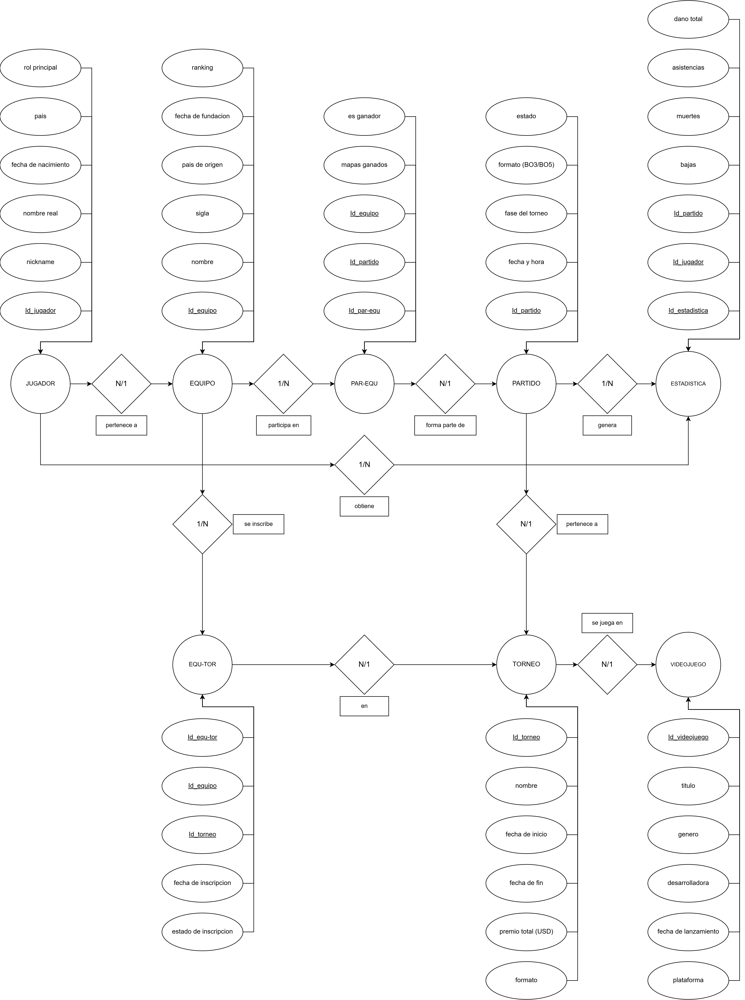

# BASE DE DATOS — Ejercicio 15: Sistema de Gestión de Torneos de Esports y Ligas de Videojuegos

Trabajo práctico de Base de Datos (Universidad Champagnat). Este repositorio contiene todo el desarrollo del ejercicio 15: modelo entidad-relación, modelo relacional y normalización (1FN, 2FN y 3FN).

## Consigna


#### Contexto

Una organización de deportes electrónicos (Esports) requiere un sistema para administrar la inscripción de equipos profesionales, la programación de enfrentamientos en distintas ligas, el registro de estadísticas en partidas y la tabla de posiciones en tiempo real.


#### Consigna

Diseñar el esquema conceptual para la gestión de torneos de videojuegos considerando las reglas de negocio detalladas:

La organización administra videojuegos oficiales (ej. League of Legends, Valorant, Counter-Strike). De cada videojuego se registra su código, nombre, género y desarrollador.

Se organizan torneos y ligas. Cada torneo posee un ID de torneo, nombre, fecha de inicio, fecha de fin y el videojuego al que pertenece.

Los equipos participantes se componen de jugadores profesionales. De cada equipo se conoce su tag abreviado, razón social, país de origen y fecha de fundación. Un jugador (ID de jugador, nickname, nombre real, nacionalidad) pertenece a un único equipo en un torneo dado, y un equipo agrupa a múltiples jugadores.

Los equipos se inscriben en los torneos. En el marco de un torneo, se programan encuentros (partidos). Un partido enfrenta a dos equipos contrincantes, registrando la fecha y hora de juego, el resultado final (sets o mapas ganados por cada uno) y el equipo ganador.

En cada partido disputado, los jugadores individuales generan estadísticas de rendimiento (ej. bajas, muertes, asistencias, daño total infligido), las cuales deben registrarse de manera precisa.


#### Desarrollo requerido


Modelar las entidades Videojuego, Torneo, Equipo y Jugador, estableciendo las relaciones de pertenencia y participación.

Diseñar la inscripción N:M entre Equipo y Torneo.

Estructurar el Partido como entidad asociativa entre dos equipos en el contexto de un torneo.

Incorporar el registro de Estadísticas de Jugador por partido disputado, asegurando la integridad de los datos cuantitativos.

## Estructura del repositorio

```
BASE_DE_DATOS_Ejercicio_15/
├── README.md
├── modelo-er/
│   ├── ejercicio_15.drawio        # diagrama editable (draw.io)
│   └── ejercicio_15.png           # exportación del diagrama
├── modelo-relacional/
│   ├── ejercicio_15_MR.xlsx               # modelo relacional
│   └── ejercicio_15_con_datos.xlsx        # modelo relacional con datos de ejemplo
└── normalizacion/
    ├── ejercicio_15_1FN.xlsx
    ├── ejercicio_15_2FN.xlsx
    └── ejercicio_15_3FN.xlsx
```

## Modelo entidad-relación



Archivo editable: [`modelo-er/ejercicio_15.drawio`](modelo-er/ejercicio_15.drawio).

## Modelo relacional

Tablas del modelo relacional original, antes de normalizar (`(PK)` clave primaria, `(FK)` clave foránea, `(UNIQUE)` valor único):

- **VIDEOJUEGO**: `Id_videojuego(PK)`, `titulo`, `genero`, `desarrolladora`, `fecha de lanzamiento`, `plataforma`
- **TORNEO**: `Id_torneo(PK)`, `nombre`, `fecha de inicio`, `fecha de fin`, `premio total (USD)`, `formato`, `Id_videojuego(FK)`
- **EQUIPO**: `Id_equipo(PK)`, `nombre`, `sigla`, `pais de origen`, `fecha de fundacion`, `ranking`
- **JUGADOR**: `Id_jugador(PK)`, `nickname`, `nombre real`, `fecha de nacimiento`, `pais`, `rol principal`, `Id_equipo(FK)`
- **EQU-TOR**: `Id_equ-tor(PK)`, `Id_equipo(FK, PK)`, `Id_torneo(FK, PK)`, `fecha de inscripcion`, `estado de inscripcion`
- **PARTIDO**: `Id_partido(PK)`, `fecha y hora`, `fase del torneo`, `formato (BO3/BO5)`, `estado`, `Id_torneo(FK)`
- **PAR-EQU**: `Id_par-equ(PK)`, `Id_partido(FK, PK)`, `Id_equipo(FK, PK)`, `mapas ganados`, `es ganador`
- **ESTADISTICA**: `Id_estadistica(PK)`, `Id_jugador(FK, PK)`, `Id_partido(FK, PK)`, `bajas`, `muertes`, `asistencias`, `dano total`

Archivos: [`ejercicio_15_MR.xlsx`](modelo-relacional/ejercicio_15_MR.xlsx) y [`ejercicio_15_con_datos.xlsx`](modelo-relacional/ejercicio_15_con_datos.xlsx).

## Lógica relacional

Cada entidad se convierte en una tabla con su clave primaria. Las relaciones se representan así:

- **1:N / N:1**: la clave primaria del lado "uno" se copia como clave foránea (FK) en la tabla del lado "muchos".
- **1:1**: igual que 1:N, pero la FK lleva restricción UNIQUE.
- **N:M**: se crea una tabla intermedia cuyas FK forman una clave compuesta, junto con una clave propia que se identifica por esa combinación.

Relaciones del modelo final (3FN):

- `TORNEO` → `VIDEOJUEGO`: **N:1** (FK `id_videojuego` en `TORNEO`).
- `JUGADOR` → `EQUIPO`: **N:1** (FK `id_equipo` en `JUGADOR`).
- `EQUIPO` ↔ `TORNEO`: relación **N:M**, resuelta con la tabla intermedia `EQU-TOR` (sus FK forman la clave compuesta única).
- `PARTIDO` → `TORNEO`: **N:1** (FK `id_torneo` en `PARTIDO`).
- `PARTIDO` ↔ `EQUIPO`: relación **N:M**, resuelta con la tabla intermedia `PAR-EQU` (sus FK forman la clave compuesta única).
- `JUGADOR` ↔ `PARTIDO`: relación **N:M**, resuelta con la tabla intermedia `ESTADISTICA` (sus FK forman la clave compuesta única).

## Normalización

Los cambios se muestran etapa por etapa; cada etapa parte del resultado de la anterior.

### Primera forma normal (1FN)

Sin cambios respecto de la etapa anterior: el modelo ya cumplía esta forma normal.

### Segunda forma normal (2FN)

Sin cambios respecto de la etapa anterior: el modelo ya cumplía esta forma normal.

### Tercera forma normal (3FN)

- `PAR-EQU`: se quitan `es ganador`

#### Modelo final en 3FN

- **VIDEOJUEGO**: `Id_videojuego(PK)`, `titulo`, `genero`, `desarrolladora`, `fecha de lanzamiento`, `plataforma`
- **TORNEO**: `Id_torneo(PK)`, `nombre`, `fecha de inicio`, `fecha de fin`, `premio total (USD)`, `formato`, `Id_videojuego(FK)`
- **EQUIPO**: `Id_equipo(PK)`, `nombre`, `sigla`, `pais de origen`, `fecha de fundacion`, `ranking`
- **JUGADOR**: `Id_jugador(PK)`, `nickname`, `nombre real`, `fecha de nacimiento`, `pais`, `rol principal`, `Id_equipo(FK)`
- **EQU-TOR**: `Id_equ-tor(PK)`, `Id_equipo(FK, PK)`, `Id_torneo(FK, PK)`, `fecha de inscripcion`, `estado de inscripcion`
- **PARTIDO**: `Id_partido(PK)`, `fecha y hora`, `fase del torneo`, `formato (BO3/BO5)`, `estado`, `Id_torneo(FK)`
- **PAR-EQU**: `Id_par-equ(PK)`, `Id_partido(FK, PK)`, `Id_equipo(FK, PK)`, `mapas ganados`
- **ESTADISTICA**: `Id_estadistica(PK)`, `Id_jugador(FK, PK)`, `Id_partido(FK, PK)`, `bajas`, `muertes`, `asistencias`, `dano total`

Archivos: [`ejercicio_15_1FN.xlsx`](normalizacion/ejercicio_15_1FN.xlsx), [`ejercicio_15_2FN.xlsx`](normalizacion/ejercicio_15_2FN.xlsx), [`ejercicio_15_3FN.xlsx`](normalizacion/ejercicio_15_3FN.xlsx).
